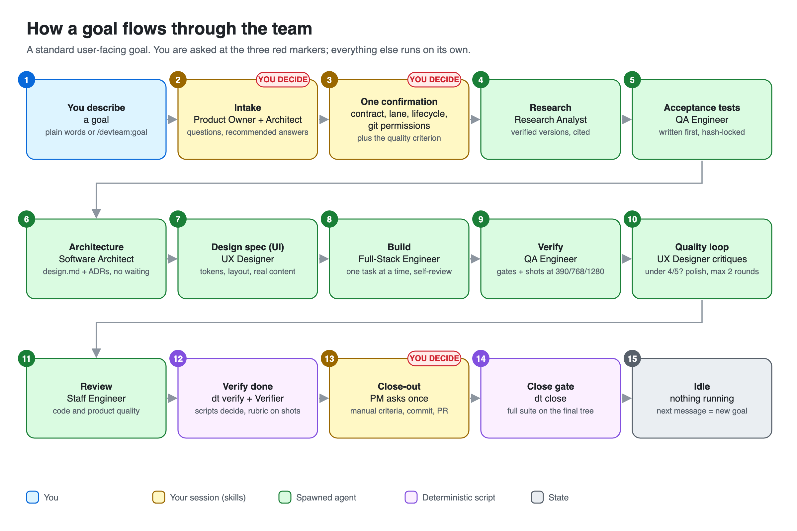
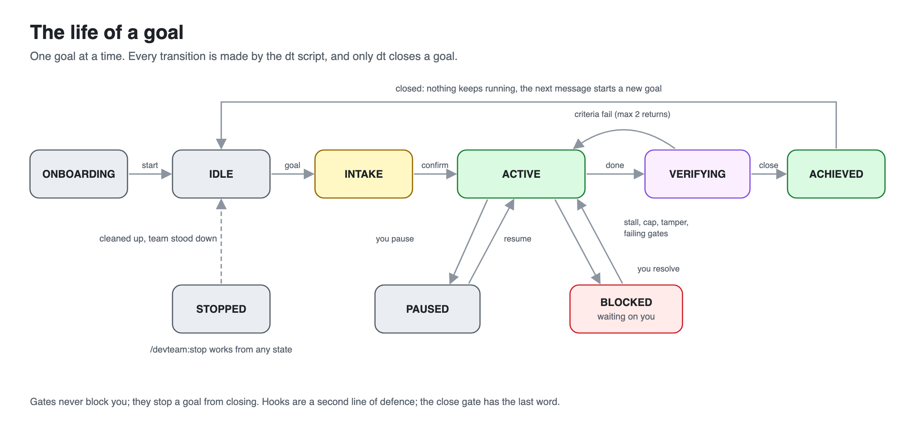
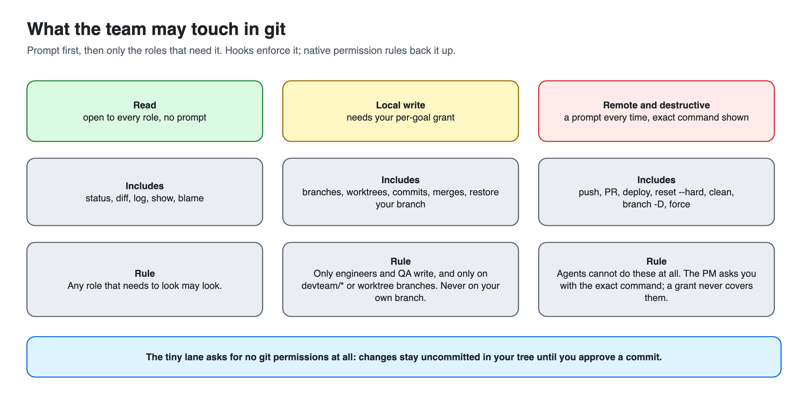
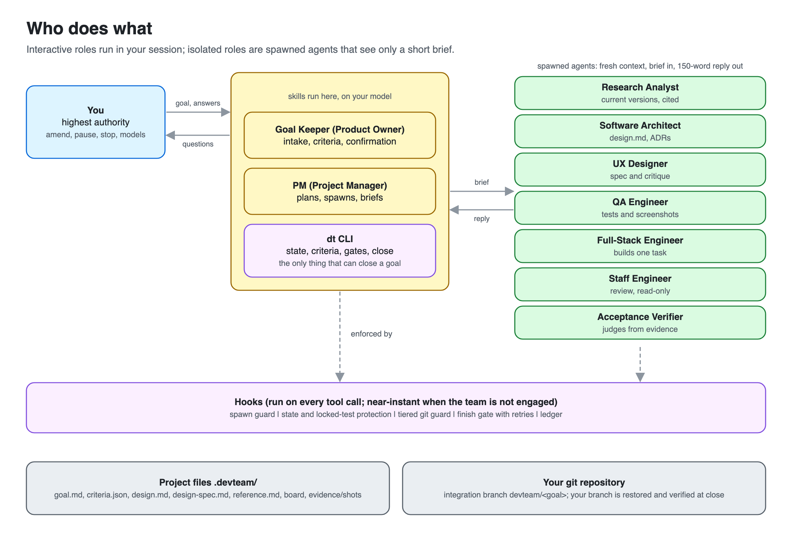

# Dev-team

[](https://github.com/Raghavrajvanshi/Dev-team/actions/workflows/ci.yml)

A goal-gated, token-lean software development team for Claude Code, packaged as the plugin **`devteam`**. It works in any git project.

- A **Goal Keeper** asks you to define the goal first. Nothing is built until you confirm it, and the team stops when the done-criteria are verified by script.
- A **PM**, an **Architect**, engineers, **QA**, a **Reviewer** and, when a change is risky, a **Security Engineer** are started one at a time, only when a step needs them.
- The PM suggests the best-fit **lifecycle** (Agile Scrum/Kanban, Waterfall, and more) and you choose.
- **You are the highest authority.** Amend, pause, stop or change models at any time. Git writes happen only after you grant them; push, PR and deploy are asked every time.
- Code quality is enforced, not requested: every agent loads a short craft charter (minimal, modular, no slop), and scope, locked tests and a close gate are checked by scripts.

> **Status: v0.1 (core loop).** Unit and CLI tests pass (613) and the plugin installs cleanly from this repo, and a first live run confirmed the plugin loads and `/devteam:start` works through preflight, init and engage. The rest of the flow has not yet been exercised end to end. See [Status and known limits](#status-and-known-limits).

## How it works



*A standard user-facing goal. You are asked at the three red markers; everything else runs on its own.*

<table>
<tr>
<td width="50%"><b>The life of a goal</b><br></td>
<td width="50%"><b>What the team may touch in git</b><br></td>
</tr>
</table>



Diagrams are generated from [`docs/images/generate.py`](docs/images/generate.py) (`scripts/diagrams` also exports the PNGs).

## Requirements

| Needed | Check with | Notes |
|---|---|---|
| Claude Code **2.1.295 or newer** | `claude --version` | Older versions lack the hook failure setting the plugin relies on. Update with `claude update`. |
| `git` | `git --version` | The project must be a git repo with at least one commit. |
| Perl 5 with core modules | `perl -MJSON::PP -MDigest::SHA -e1` (prints nothing when fine) | Preinstalled on macOS and most Linux. Windows is not supported yet. |

## Install

Run these two commands in a terminal:

```bash
claude plugin marketplace add Raghavrajvanshi/Dev-team
claude plugin install devteam@devteam-marketplace
```

Or, from inside a Claude Code session:

```
/plugin marketplace add Raghavrajvanshi/Dev-team
/plugin install devteam@devteam-marketplace
```

Then restart Claude Code (or run `/reload-plugins`) and check it:

```bash
claude plugin list        # devteam@devteam-marketplace  Version 0.2.4  enabled
```

In a session, typing `/devteam:` should list the commands below.

By default the plugin installs for you (`--scope user`) and is available in every project, but it stays **idle until you run `/devteam:start`** in a project. Use `--scope project` to enable it for everyone on one repository.

**Try it without installing:**

```bash
git clone https://github.com/Raghavrajvanshi/Dev-team.git
cd your-project && claude --plugin-dir ../Dev-team/plugins/devteam
```

**Update, disable, uninstall:**

```bash
claude plugin marketplace update devteam-marketplace
claude plugin update devteam@devteam-marketplace     # restart Claude Code to apply
claude plugin disable devteam@devteam-marketplace    # switches every hook off
claude plugin uninstall devteam@devteam-marketplace
```

## Use it

Open Claude Code in your project and follow these steps.

**1. Start the team: `/devteam:start`** (once per project)
It checks your setup (Claude Code version, git repo with a commit, clean working tree) and offers a fix for anything missing, never applying it without your yes. The first time, it asks **one question: use the recommended models, or customise?** (recommended is pre-selected). It then scans the project cheaply into `.devteam/profile.md`, records the project's test and lint commands, and offers an allow-list so the team does not stop at every command. You approve each of these.

**2. Describe a goal in plain words**
For example: *"Add a /health endpoint that returns {status: ok}, with a test."* (or `/devteam:goal <text>`). If you skipped the one-time setup (model choice, project scan), the goal flow finishes it first instead of failing. The Goal Keeper asks only what it cannot infer (the Architect adds up to three technical questions), each with a recommended answer, so "go with your recommendations" works. Then you get **one combined confirmation**:

| You confirm | Examples |
|---|---|
| The contract | Objective, scope, non-goals, and done-criteria like *WHEN GET /health THEN 200 and `{"status":"ok"}`* |
| The lane | *tiny* (inline, no agents), *standard*, or *large* |
| The lifecycle | The PM's suggestion with its reasons, the runner-up, "show all", or type any name |
| Git permissions | Whether the team may create `devteam/<goal>`, commit on it, merge into it, and switch back |

**3. The team works.** You see short summaries. You are asked again only for **exceptions** (a cap is reached, tests keep failing, a command is not allow-listed, anything that would push or deploy) and **once at close-out**: open manual criteria, whether to commit, and whether to open a PR (the exact commands are shown).

**4. It stops.** When every criterion is verified by script, the goal closes with a short report in `.devteam/goals/<id>/closure.md`, your original branch is restored, and nothing keeps running. Your next message starts a new goal.

**How a goal can end.** The report and `dt status` always say which:

| Outcome | Means |
|---|---|
| `verified` | Every criterion passes and the gates are green. |
| `partial` | You accepted a goal with some criteria still open. It needs a reason in your words, and the report lists every open criterion. At least one criterion must pass, and a changed locked test, an edited protected file or a moved branch can never close this way. |
| `failed` | The goal was stopped before it closed. |
| `blocked` | The goal was stopped while it was waiting on you. |

When work will not fully verify, the PM shows you the unmet criteria and offers: keep going, amend the criteria, accept as partial, or stop. Nothing is quietly dropped to make a goal pass.

### Commands

| Command | Use it to |
|---|---|
| `/devteam:start` | Engage the team in this project; resume a paused or blocked goal |
| `/devteam:goal [text]` | Define and confirm a new goal (a plain message does this too once engaged) |
| `/devteam:amend <change>` | Change criteria, scope, lane, lifecycle or git permissions mid-goal |
| `/devteam:status` | See state, board, criteria, spawns and usage |
| `/devteam:pause` | Pause (a running agent finishes its step; nothing new starts) |
| `/devteam:stop` | Stop now, clean up and disengage |
| `/devteam:changemodels` | Pick team members, then set their model and effort |
| `/devteam:lifecycle [name]` | Show or change the process lifecycle |
| `/devteam:ask <role> <question>` | One-off consult with a role (read-only) |
| `/devteam:selftest` | In a scratch repo, check what Claude Code really does with the plugin (see below) |

### The team

Every role is a person with a title. **Names are drawn at random when the team is first needed** (at `/devteam:start`), kept for the whole engagement, and never repeat within a team; `/devteam:stop` stands the team down, so the next engagement draws new people. Titles and role ids are fixed. Talk to them naturally (`/devteam:ask <first name> ...`; `/devteam:changemodels` accepts first names too). Run `dt team` to see who is on the team now, and `dt team --reroll` to draw again.

| Title | Role id | Runs as |
|---|---|---|
| Product Owner (Goal Keeper) | `goal-keeper` | intake, in your session |
| Project Manager and Scrum Master | `project-manager` | the PM, in your session |
| Software Architect | `architect` | agent |
| Full-Stack Engineer | `fullstack-engineer` | agent |
| QA Engineer | `qa-engineer` | agent |
| Staff Engineer (code review) | `reviewer` | agent |
| Security Engineer | `security-engineer` | agent, read-only; started when `dt risk` finds a trigger |
| Acceptance Verifier | `goal-verifier` | agent |
| Research Analyst | `researcher` | agent |
| UX Designer | `ux-designer` | agent |

Planned: Backend, Frontend, Mobile, DevOps and Technical Writer roles. Names come from `plugins/devteam/names.txt`; they are generated, not assigned, and any resemblance to real people is coincidental.

### How the team thinks

Passing checks is not the same as good work, so the process is built around quality, not just completion:

1. **Research first, never from memory.** The Research Analyst establishes what is current (verified versions, current idioms, how leading examples in the domain are built) and writes a cited `reference.md`; topics are cached in `.devteam/knowledge/` for 30 days. The Architect and designers can search and fetch the web too, and engineers can confirm an API in the docs.
2. **Design before building** for anything user-facing: the UX Designer writes a design spec (art direction, tokens, layout, real content, imagery plan, motion, states) from the reference and any live examples you give.
3. **Look at the result.** `dt shot` takes headless-Chrome screenshots at 390, 768 and 1337. Engineers review their own screenshots, QA captures every page, and the Designer scores them against a rubric (hierarchy, typography, spacing, colour, imagery, depth, motion, responsiveness, content depth, fidelity).
4. **Polish until it passes.** Anything under 4 of 5 goes back to an engineer with concrete fixes, for up to two rounds; if it still fails you see the scores and screenshots.
5. **Quality is a criterion.** Intake adds a quality criterion for user-facing goals, so "looks good" is verified, not only "pages load". Engineers and the Reviewer think at high effort by default.
6. **Minimal means no waste, not low ambition.** Size budgets guard against padding and are never a reason to cut design fidelity or content.
7. **Risky changes get a security look.** `dt risk` (a script, no model call) checks the planned files and the finished diff against the triggers in [`plugins/devteam/risk.tsv`](plugins/devteam/risk.tsv): authentication, payments, secrets, uploads and webhooks, pipelines, dependency manifests and migrations by path, and by added line `eval` and shell calls, unsafe deserialization, string-built SQL, `innerHTML` and disabled TLS checks. When one fires, or the goal's risk is high or regulated, the read-only Security Engineer reviews the design for threats (STRIDE) before code and the diff for exploitable flaws (OWASP Top 10) after it, and reports only what an attacker can reach. A match is a reason to look, not a finding; edit `risk.tsv` to tune it. This complements, and does not replace, Claude Code's own `security-guidance` plugin and `/security-review`, and the scanners in your CI.

### Lanes and lifecycles

- **Lane** is how big the work is: *tiny* (one file or a small fix, **zero agents**), *standard* (a feature in existing code), *large* (several modules). Each lane caps how many agents may start.
- **Lifecycle** is the process shape, chosen by you from the PM's suggestion: `direct`, `agile-kanban`, `agile-scrum`, `waterfall` today. Each is a short file in [`plugins/devteam/lifecycles/`](plugins/devteam/lifecycles); add your own in `.devteam/lifecycles/<name>.md`, starting from `_template.md`.

### What it creates in your project

- `.devteam/` (it offers to hide it from `git status` through `.git/info/exclude`; your tracked `.gitignore` is never touched): state, config, `profile.md`, `standards.md`, and `goals/G-001/{goal.md, criteria.json, board.md, closure.md}`. Safe to read, and you may edit `goal.md` freely. Changes to `criteria.json`, `state.json` or `config.json` made outside the team's tools are detected and block the goal; ask Claude to run `dt resync` to accept a deliberate edit.
- A git branch `devteam/G-001`, only if you grant it. Your own branch is restored at the end and its tip is verified unchanged.

### Several Claude sessions in one repository

Two sessions editing the same working tree can overwrite each other, and the team's acceptance tests are the first thing to suffer. The strongest fix is the one Claude Code documents: give each parallel session its own worktree (`claude --worktree <name>`), so their files are separate. When sessions do share a tree, the team notices and asks instead of carrying on:

- **At `/devteam:start`:** if another live session shares this working tree, or another session still holds the team, you are asked to choose (continue alongside it, work in a separate worktree, take the team over, or stop). Nothing changes until you choose.
- **Before each spawn:** a live session you have not acknowledged for this goal blocks the spawn until you answer once.
- **After each task:** the PM records the task's allowed files (`dt scope start`) and checks the tree afterwards (`dt scope check`). Anything changed outside them is listed, with the other session's name when the hooks saw it write. You keep it or remove it; a goal will not close while any of it is unresolved.

`dt sessions` shows what the team can see. Liveness comes from Claude Code's session registry (`~/.claude/sessions`, an undocumented format seen on 2.1.295) and is used only when it lists the asking session itself; otherwise it falls back to recent transcripts and to what the hooks observed. A session counts as live when it is busy or was active within 30 minutes (`sessions.live_secs` in `.devteam/config.json`). This detects and warns; it cannot prevent a write, and other editors and tools are invisible to it.

## Cost

`claude plugin details devteam` reports the plugin's footprint: about **930 tokens added to every session** (v0.2.8; each agent adds its one-line description, about 30 to 40); hooks cost no model tokens. Skills and agents cost tokens only when they run (for example `goal` about 1.8k, `orchestrate` about 3.5k, a Security Engineer spawn about 1.1k). Gate results are cached by exact code state so an identical tree is never tested twice, and hooks take about 2–4 ms when the team is not engaged. Savings versus a plain session are not claimed until you measure them; the usage ledger (`/devteam:status`) records spawns and tokens by model.

## Troubleshooting

| Symptom | What to do |
|---|---|
| Preflight says `FAIL claude-version` | `claude update`, then restart |
| `FAIL git` or `FAIL clean-tree` | Make an initial commit; commit or stash your changes, then rerun `/devteam:start` |
| `dt: command not found` | Restart Claude Code or `/reload-plugins`. If it persists, tell Claude to run `dt` by its full path inside the installed plugin folder (`claude plugin list` shows where), and report it |
| Goal is `BLOCKED` | `/devteam:status` shows why. Resolve it and run `/devteam:start` to resume, or `/devteam:stop` |
| The team is in the way of normal work | `/devteam:stop`, or `claude plugin disable devteam@devteam-marketplace` |

## Check your install: the self-test

Several behaviours (how Claude Code passes agent ids to hooks, whether plugin skills preload into agents, the model override on spawn) could only be assumed when the plugin was written. `/devteam:selftest` settles them from evidence. Run it in a **scratch git repo**: it starts four cheap probe agents and attempts a few actions that must be refused, then prints a checklist.

```
/devteam:selftest
dt trace report          # the checklist: confirmed, refuted, suspect or unseen for each assumption
dt trace show --tail 60  # the raw records behind it
```

Tracing is off by default and costs nothing; `dt trace on` (or `DT_TRACE=1`) makes every hook record its input and decision to `.devteam/trace.jsonl`. Those records are local, gitignored, and may hold fragments of prompts and commands. If a line says `refuted` or `suspect`, please send the report: that is exactly the data used to fix the plugin.

## Status and known limits

**Tested** (`prove tests/`): the `dt` CLI (state machine, goals, hash-locked criteria, verification, tree-hash gate cache, close gate and its four outcomes, lifecycle selector, model/effort settings, git grants, session detection and scope checks), the git command classifier, and every hook. `claude plugin validate --strict` passes for the marketplace, plugin, skills and agents, and a fresh install from this repo works.

**Confirmed in a first live run:** the plugin loads from the marketplace, `/devteam:start` runs, preflight, `dt init` and `dt engage ${CLAUDE_SESSION_ID}` work, and `dt` resolves. Live runs also found and fixed four bugs: `changemodels` was user-only so `start` could not use it, `.gitignore` edits left the tree dirty (now `.git/info/exclude`), the first commit could sweep in `.DS_Store` and `.claude/` (now it shows the file list and asks), and `/devteam:goal` ran before setup was finished (it now completes setup first via the `setup` skill).

**Confirmed in live sessions** (the first real run, and `/devteam:selftest`, 10 October 2026): the plugin loads from the marketplace; `dt` resolves from the plugin's `bin/`; the `Agent` tool input carries `subagent_type`, `model`, `effort` and `isolation`; `agent_id` and `agent_type` (`devteam:<role>`) reach hooks on subagent calls; subagent writes to protected state and subagent pushes and commits are denied; the spawn guard refuses an untyped agent and a worktree spawn without a grant; the `model` passed on spawn is the model the agent runs as; `craft` and `design-quality` preload into agents; subagent token usage reaches the ledger.

**Found and fixed by the self-test:** a bare skill name can resolve to another installed plugin's skill (our `research` loaded someone else's). The three preloaded skills are now `devteam-craft`, `devteam-research` and `devteam-design-quality`, and PM mode invokes `devteam:orchestrate` and `devteam:goal` by qualified name.

**Still unverified live:** PM mode (`claude --agent devteam:project-manager`), the finish gate actually blocking a `SubagentStop`, and the v0.2 flow end to end on a real user-facing goal (researcher, designer, screenshots, polish loop).

**v0.1 limits:** engineers run one at a time (no worktrees or parallelism yet); onboarding is an inline scan; backend/frontend/mobile/DevOps/Writer roles and the DevOps, V-model, Spiral and Prototype lifecycles are planned. The Security Engineer has been tested offline only; `/devteam:selftest` has a probe for it that has not been run yet. macOS and Linux only.

## Develop

```bash
prove tests/                                        # 613 tests
claude plugin validate .                            # marketplace
claude plugin validate plugins/devteam --strict     # plugin
claude plugin validate plugins/devteam/skills --strict
claude plugin validate plugins/devteam/agents --strict
```

Changed the workflow? Regenerate the diagrams with `scripts/diagrams` (needs `python3` and Chrome) and commit them.

### Releasing

Every published change is a new version and a GitHub release ([releases](https://github.com/Raghavrajvanshi/Dev-team/releases), [CHANGELOG](CHANGELOG.md)):

1. Bump `version` in `plugins/devteam/.claude-plugin/plugin.json` and add a `## [x.y.z]` entry to `CHANGELOG.md`.
2. Commit and push to `main`.
3. Run `scripts/release`. It refuses unless CI is green for the commit (it waits for a running CI), and the commit is on `origin/main`, the version is new and has a changelog entry, and the tree is clean, `prove tests/` passes and `claude plugin validate --strict` is clean. The release notes are the changelog entry plus the commit, test count and install/update commands.

Layout: `plugins/devteam/{bin/dt, lib/, hooks/, skills/, agents/, lifecycles/, templates/}`. The full design and the reasoning behind it: [docs/DESIGN.md](docs/DESIGN.md).

## License

[MIT](LICENSE)
